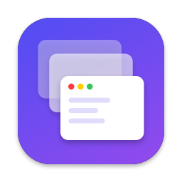
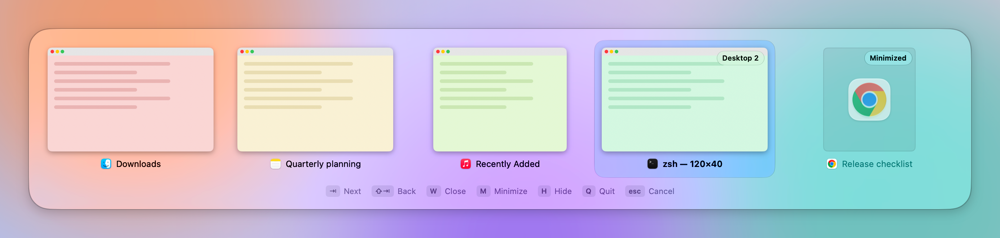

<p align="center">
  
</p>

<h1 align="center">Flick</h1>

<p align="center">
  Windows-style Alt+Tab for macOS. Hold <kbd>⌥ Option</kbd>, tap <kbd>⇥ Tab</kbd>, and flip between <em>windows</em>, not just apps.
</p>

<p align="center">
  <picture>
    <source media="(prefers-color-scheme: dark)" srcset="docs/screenshot-dark.png">
    
  </picture>
</p>

macOS's ⌘⇥ switches between apps, so getting to a particular window takes a second step. Flick shows every window, with live previews, in the order you last used them. A quick ⌥⇥ always takes you back to the window you were just in.

## Features

- **Every window:** across apps, Spaces and displays, including minimized windows and windows of hidden apps. Apps with no windows open can be included too.
- **Most-recently-used order:** a quick tap switches straight back to the previous window without flashing any UI. The panel only appears if you keep holding ⌥.
- **Live previews** via ScreenCaptureKit, falling back to app icons if you skip the Screen Recording permission.
- **Liquid Glass** on macOS 26 and later: a glass panel, a glass selection that springs from tile to tile, and glass badges. macOS 14 and 15 get a frosted HUD.
- **Window commands from the switcher:** close, minimize, hide or quit without leaving it.
- **Stays out of the way:** it lives in the menu bar, has no Dock icon and can launch at login.
- **Private by design:** no network access, no analytics. Previews are kept in memory only.

## Requirements

- **To run:** macOS 14 Sonoma or later. Liquid Glass needs macOS 26 Tahoe.
- **To build:** the macOS 26 SDK, from Xcode 26 or the matching Command Line Tools.

## Install

There are no prebuilt releases yet. Building from source takes a couple of minutes. Clone this repository, then from its folder:

```sh
scripts/make-signing-identity.sh   # optional: keeps permissions across rebuilds (see below)
make install                       # builds Flick.app, copies it to /Applications and launches it
```

On first launch Flick asks for two permissions. It explains each one and has buttons that open the right pane in System Settings.

| Permission | Why | Required? |
| --- | --- | --- |
| Accessibility | To list and focus windows, and to catch ⌥⇥ | Yes |
| Screen Recording | For live window previews. It takes effect after a restart, and Flick has a button for that | No; without it you see app icons |

> [!NOTE]
> macOS ties these permissions to the app's code signature. `scripts/make-signing-identity.sh` creates a local, self-signed certificate ("Flick Local Signing") in your login keychain, and the build script uses it automatically. That way a rebuilt Flick keeps its permissions. Without it, each build is signed ad hoc and has to be approved again.

## Usage

| While holding ⌥ | |
| --- | --- |
| <kbd>⇥</kbd> / <kbd>⇧⇥</kbd> | Next / previous window |
| <kbd>`</kbd> | Open with only the frontmost app's windows |
| <kbd>←</kbd> <kbd>→</kbd> <kbd>↑</kbd> <kbd>↓</kbd> | Move around the grid |
| Release ⌥, <kbd>↩</kbd>, or click | Switch to the selected window |
| <kbd>W</kbd> | Close the selected window |
| <kbd>M</kbd> | Minimize or restore it |
| <kbd>H</kbd> | Hide or show its app |
| <kbd>Q</kbd> | Quit its app |
| <kbd>esc</kbd> | Cancel |

The menu-bar icon has the settings: which kinds of windows to show (other Spaces, minimized, hidden apps, apps without windows) and launch at login.

## How it works

Flick is a small Swift package (AppKit + SwiftUI) with no dependencies.

| File | Role |
| --- | --- |
| [`KeyboardTap.swift`](Sources/Flick/KeyboardTap.swift) | A session-wide `CGEventTap`. It claims ⌥⇥ and ⌥\`, takes every keystroke while the switcher is open, and commits when ⌥ is released. |
| [`WindowManager.swift`](Sources/Flick/WindowManager.swift) | Builds the window list. The Accessibility API covers the visible Spaces, including minimized and hidden windows. WindowServer's list plus Space membership adds windows on other Spaces. |
| [`FocusTracker.swift`](Sources/Flick/FocusTracker.swift) | Keeps most-recently-used order, from app activations and per-app `AXObserver`s. |
| [`PrivateAPI.swift`](Sources/Flick/PrivateAPI.swift) | The private calls it relies on, loaded with `dlsym`. If one disappears in a future macOS, the related feature degrades and the app still launches. |
| [`Thumbnails.swift`](Sources/Flick/Thumbnails.swift) | ScreenCaptureKit captures, cached so the last image shows instantly while a fresh one is taken. |
| [`SwitcherController.swift`](Sources/Flick/SwitcherController.swift) | Opening, navigation, window commands and committing a switch. |
| [`SwitcherPanel.swift`](Sources/Flick/SwitcherPanel.swift), [`SwitcherView.swift`](Sources/Flick/SwitcherView.swift) | A non-activating panel: an `NSGlassEffectView` on macOS 26+, an `NSVisualEffectView` before that, hosting a SwiftUI grid. |

**About private APIs:** focusing one specific window across Spaces, and knowing which Space a window is on, need a few undocumented calls. They are `_AXUIElementGetWindow`, `_SLPSSetFrontProcessWithOptions` / `SLPSPostEventRecordTo` from SkyLight, and the `SLSCopy…Spaces` family. These are the same calls yabai, Hammerspoon and AltTab use. They're also why Flick can't be distributed through the Mac App Store.

## Known limitations

- ⌥⇥ doesn't work while a password field has Secure Input on. That's true of every event-tap-based switcher.
- Windows on other Spaces can only be closed or minimized after you've switched to them, because the Accessibility API doesn't expose them until then.
- The shortcut is fixed at ⌥⇥ for now. Don't run Flick alongside another switcher on the same shortcut.

## Uninstall

Quit Flick from its menu, delete `/Applications/Flick.app`, then optionally clear its permissions and settings:

```sh
tccutil reset All local.flick.Flick
defaults delete local.flick.Flick
```

If you created the signing identity, delete "Flick Local Signing" in Keychain Access → login → My Certificates.

## Contributing

Issues and pull requests are welcome. [CONTRIBUTING.md](CONTRIBUTING.md) covers the development setup and the debug helpers that let you check UI changes without clicking through them by hand.

## Acknowledgements

Inspired by the Windows Alt+Tab switcher and by [AltTab](https://github.com/lwouis/alt-tab-macos). The window-focusing and Space techniques come from the wider macOS window-management community, especially [yabai](https://github.com/koekeishiya/yabai) and [Hammerspoon](https://github.com/Hammerspoon/hammerspoon). Flick's code is its own.

## License

[MIT](LICENSE) © 2026 Ashutosh Kalambe
